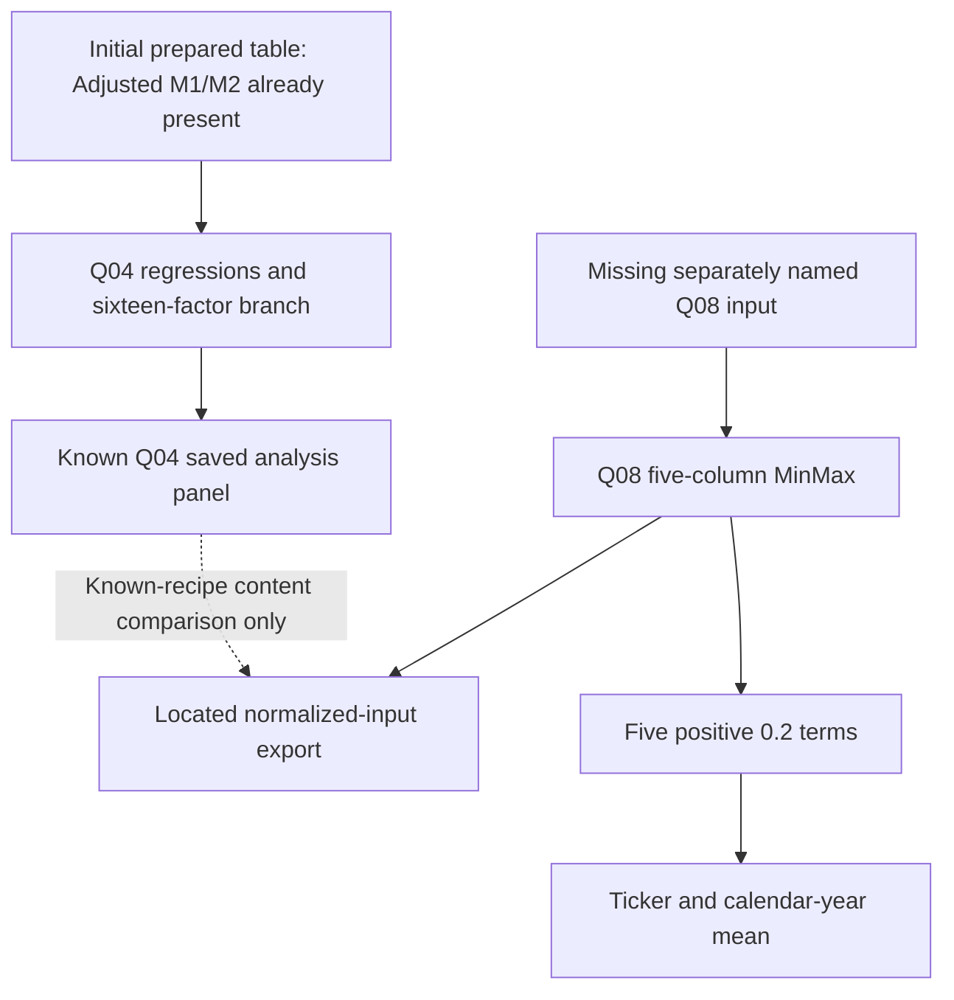

# Integrity source history and the recovered five-component branch

Prepared 2026-10-22, America/Toronto, under SRG-RD-002. This follows the
[earlier definition-gap audit](integrity-definition-gaps-2026-10-22.md).
An additional private notebook and its normalized export have now been found.
They recover an explicit five-component implementation, but not the upstream
Adjusted M1/M2 formulas or the report's signed formula as an executable chain.

## New source Q08

Q08 is a separately located notebook, 424,025 bytes, SHA-256
`0d893c72c487b150a302cc5a80759e1bbd71156ec4f8bada91494e1124f5994f`.
Its 30 JSON cells contain 29 code cells, including one empty cell. It was
outside the original seven notebooks and seven hidden checkpoints. Source
locations below are zero-based JSON cell indices. Stored execution counters
and displays are evidence of saved state, not proof of a complete ordered run.

| Stage | Direct source evidence | Operational meaning |
| --- | --- | --- |
| Input, cells 1–2 | Reads a separately named prepared table, then selects company/ticker/date/fiscal labels, five components and a future-return context field | The named input and its writer have not been located. The return field is retained context, not a scaler input. |
| Scaling, cell 3 | Default `MinMaxScaler.fit_transform` on the five selected columns over the entire supplied panel | Per-column range 0–1, no sign reversal, no date/industry/training split, no explicit outlier treatment. |
| Export, cell 4 | Writes normalized inputs before adding the score in source order | The located export actually contains 12 columns including an index; no score or annual aggregate is present. |
| Row score, cell 5 | All five normalized columns receive coefficient +0.2 and are summed | This is a positive equal-weight branch, different from the report's signed terms. |
| Date/year, cells 6–7 | Converts Excel-serial dates using origin 1899-12-30; groups by ticker and calendar year and takes the score mean | Calendar-year aggregation, not a fiscal-year or verified four-quarter annual score. The annual value is merged back to input rows. |

The five inputs, in source order, are `chi2_d1`, `chi2_d2`, `adj_M_score1`,
`r2_lag1`, and `r2_lag2`. For finite, nonconstant columns, its normalization
is `(x - panel_min) / (panel_max - panel_min)`. The row score is:

```text
Q08 score = 0.2 * (minmax(Chi2 D1) + minmax(Chi2 D2)
                 + minmax(Adjusted M1) + minmax(R2 Lag1) + minmax(R2 Lag2))
```

The source calls library defaults without pinning historical dependencies.
The [current scaler documentation](https://scikit-learn.org/stable/modules/generated/sklearn.preprocessing.MinMaxScaler.html)
specifies the 0–1 range and preserves NaNs during transformation. The
[pandas sum contract](https://pandas.pydata.org/pandas-docs/version/2.2/reference/api/pandas.DataFrame.sum.html)
uses `skipna=True, min_count=0`: a partly missing row is not reweighted, and an
all-missing row sums to zero. Synthetic checks in the current audit environment
confirmed those cases and a constant training feature mapping to zero. These
are recorded legacy behaviors, not newly accepted research missingness rules.

The [machine-readable contract](integrity-fixed-five-contract.json) assigns
this recovered branch the identifier `legacy_q08_minmax_equal5_v1`. That name
does not promote it to the unique intended Integrity Score or a usable
historical signal. No production factor or replacement Adjusted M has been
implemented by this documentation change.

## Artifact comparison and the remaining input-chain break

The located normalized-input export has SHA-256
`b88a923a2d0a4373a5504c07cc036a867a2edddabe3f533e92cfc3ac263b70f3`,
2,887,957 bytes, 19,228 rows and 12 columns. Its schema agrees with the
pre-score export stage in Q08. The missing named input's saved column listing
has additional later-stage fields; it is not a byte-identical recovered copy
of the known Q04 export merely because row counts agree.

A newly authored read-only audit compared the Q08 normalized export with the
known Q04 saved analysis panel, SHA-256
`0befad0b118dc04bd4b6ee27a64f369ff7df03bea628619f0377e67568e7d93f`:

- Both have 19,228 nonmissing, unique ticker/fiscal-year/fiscal-quarter
  comparison keys, in the same order. These are comparison keys, not certified
  stable company or security identities.
- All six retained context fields match: company name, ticker, date, fiscal
  year, fiscal quarter and the saved five-year-return field.
- Applying the independently located Q08 MinMax recipe to the five raw
  component columns in the known Q04 panel matches all **96,140** normalized
  values at absolute tolerance `1e-10`, relative tolerance zero. Maximum
  absolute error is `3.2374276870417162e-15`.
- Both source file hashes were unchanged after the audit. The audit used
  pandas 2.2.3, NumPy 2.5.4 and scikit-learn 1.9.1; those versions are not a
  recovered historical environment.

This establishes **content compatibility with an explicit known recipe**.
It does not recover the missing table, its export code, author, run order,
full-row provenance or the Adjusted M1 formula. Neither a saved row score nor
an annual-score output is present in this export, so neither was compared.
No original notebook, market study or return model was executed.



There is no recovered assembly edge into the initial prepared table, nor a
writer connecting Q04's later-stage panel to Q08's named input. Q07's separate
raw-extract-to-merged-output branch does not create Adjusted M1/M2; it must not
be relabeled as the missing upstream chain.

## History search: scope and negative findings

| Search scope | Reviewed evidence | Result and boundary |
| --- | --- | --- |
| Existing local Git repositories | 15 related repositories; 118 distinct commits and 461 distinct selected code/document blobs across copies; 37 notebook blobs / 384 actual code cells | All local refs, HEAD and reflog tips and their reachable histories were read. No original named Adjusted M generator or initial-table writer was found. The original financial-quality source folder itself is not a Git repository. |
| Accessible related GitHub repositories | Four public repositories; 84 commits and 465 source text/header blobs summed by repository; 18 notebook versions / 161 code cells | Included advertised heads, 14 retained PR heads, and historical deleted-file contents reachable from those refs. Original named generators/writer were not found. These totals overlap local history and must not be added as independent sources. |
| Additional local versions | All 46 Downloads notebooks / 1,004 actual code cells; old retained copies deduplicated by hash; nine ZIP directories inspected for relevant members | Located Q08 and the normalized export. No further named Adjusted M generator, missing Q08 input, or initial-table writer was found within this scope. ZIP directory checks are not full archive-content searches. |
| Connected existing material | Targeted exact-name/source-attachment mail queries and retained project material | No independent generator located. Recent audit prose and restoration code are derivative references, not original formula evidence. |

All local historical repositories were non-shallow, and their refs/HEAD/reflog
snapshots were unchanged. Historical code was read as immutable blobs; it was
not executed. Actual notebook code cells were parsed, rather than treating
saved output as code. Some malformed historical cells failed AST parsing but
were still included in full source-text searches. The aggregate
[evidence record](integrity-source-history-evidence-2026-10-22.json) separates
the local, remote and new-source scopes.

The search does not cover inaccessible accounts, expired reflogs, unreachable
or garbage-collected objects, unavailable LFS contents, or all external cloud
files. It cannot prove that a generator never existed.

## Adjusted M remains upstream of the recovered branch

Q08 consumes Adjusted M1 without defining it. In a separate comparison branch,
cell 23 renames an input `M_score` column to `adj_M_score1` while explicitly
labeling the equivalence as an assumption. That branch later uses three terms
with coefficient 0.333. Neither a rename nor a differently scoped three-term
score establishes the M1/M2 generating formula. The earlier Excel
NI-minus-quarterly-CFO / normal-CDF variant likewise remains unbound.

Local download-origin metadata now identifies Drive-hosted originals for the
initial table and Q08. This is a concrete next source lead, not authenticated
authorship or a version-history result. Original file identifiers and download
URLs remain private. Google Drive access has been offered but is not confirmed;
the cloud originals and their accessible related material have not been read
in this audit. That source-dependent work remains pending connection/access.

## Execution definition decision

Three distinct definitions must retain separate identities:

| Version | What is established | What prevents substitution |
| --- | --- | --- |
| Report signed five-term statement | `+.2 Chi_d2 -.2 Chi_d1 +.2 AdjM1 -.2 R2_L1 +.2 R2_L2` | Exact transformed inputs and executable lineage are unproven. |
| Q08 `legacy_q08_minmax_equal5_v1` | Fixed five, full-panel MinMax, five positive coefficients, calendar-year mean | Adjusted M source and named input/writer remain missing; two directions differ from the report. |
| Q04 broader exploration | Sixteen retained columns, signed pooled z-scores and PCA/equal/return-weighted branches | It is not either five-component version and uses whole-panel/future-return information. |

The recovered Q08 execution contract is now explicit **from supplied component
columns forward**. It is the appropriate historical reference for that branch,
with its limitations preserved. Combining its MinMax rules with the report's
two negative signs would create a new definition, not restore either source.

The next source-dependent step is to follow the original Drive files and
related available versions/material for (1) the named M1/M2 generating
formulas and (2) the missing assembly/export chain. After that, select which
version is intended as the canonical specification and validate a predeclared
bounded sample. Until those links and the direction disagreement are resolved,
no single end-to-end historical Integrity definition is certified.
